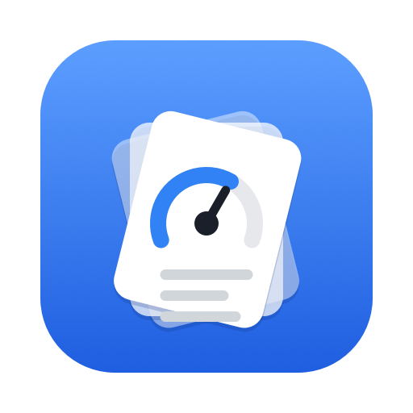
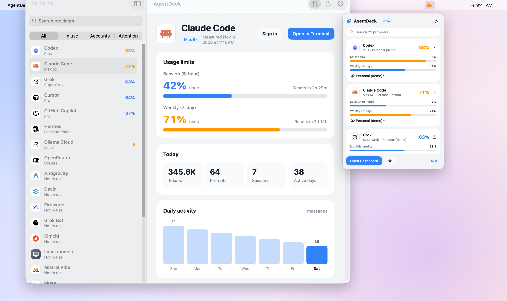
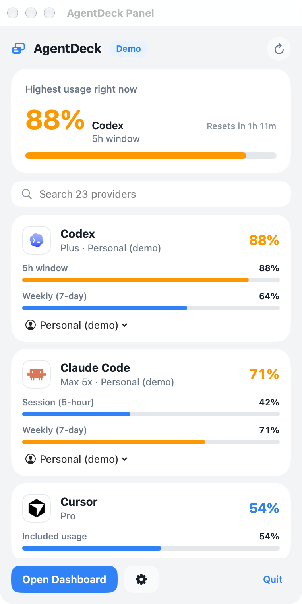
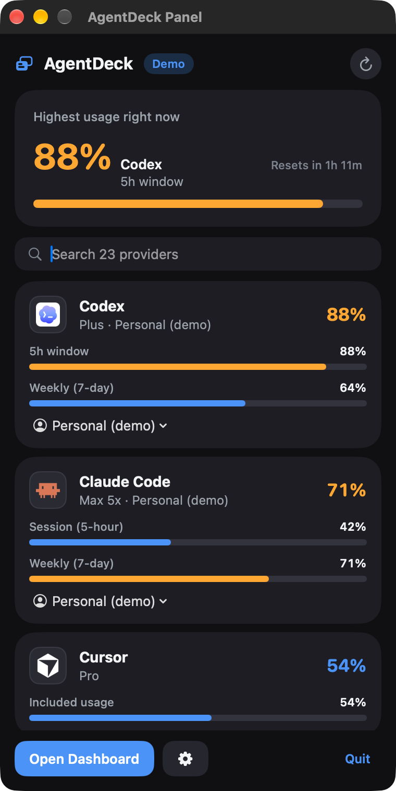
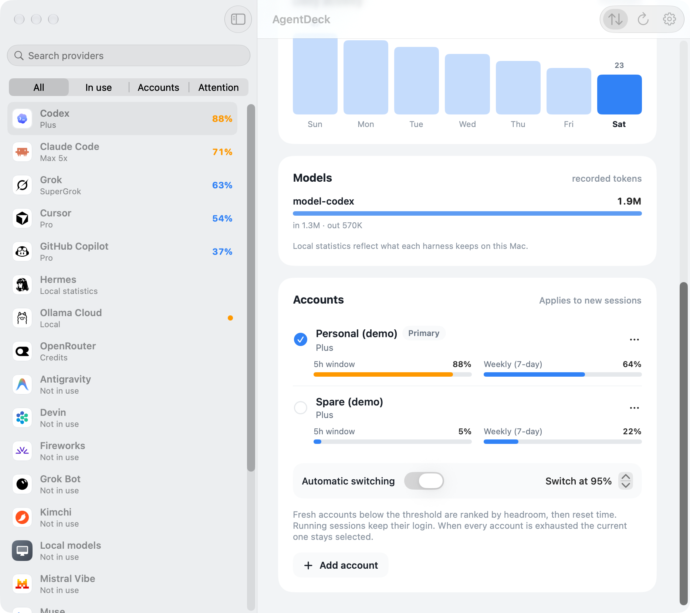
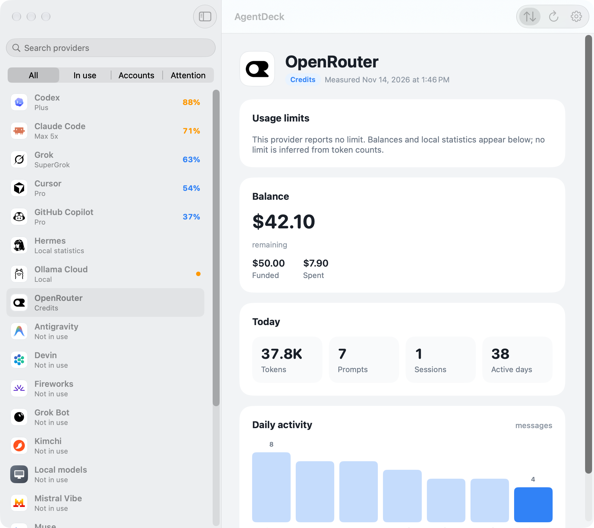
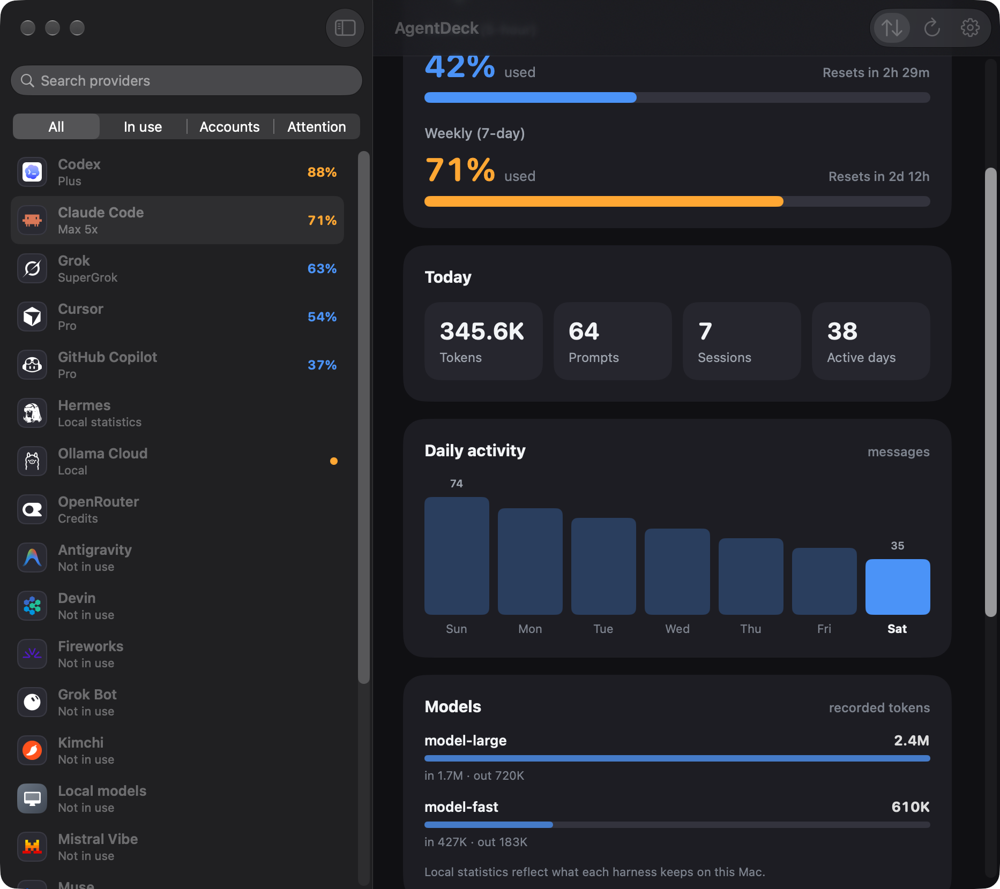
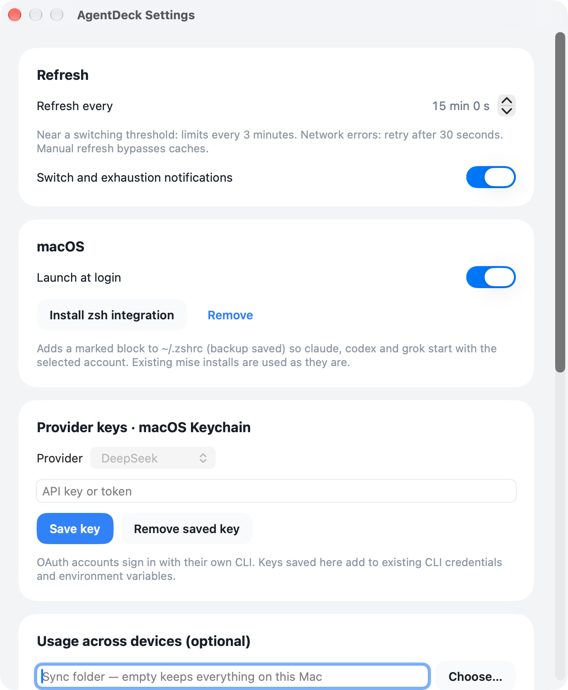

<p align="center"></p>

<h1 align="center">AgentDeck</h1>

<p align="center"><b>AI 코딩 에이전트의 한도·잔액·계정을 Mac 메뉴 막대 한곳에서.</b><br>
<a href="https://jdk1021.github.io/agentdeck/">웹사이트</a> · <a href="README.md">English</a></p>

> **[Omarchy](https://github.com/omacom/omarchy)의 소스코드를 바탕으로 만들었습니다.** AgentDeck의
> 23개 사용량 수집기는 Omarchy(MIT, David Heinemeier Hansson과 Omarchy 기여자들)의 에이전트 사용량
> 도구 `v4.5.0`에서 가져왔습니다. 한도 조회 엔드포인트, 하네스 간 청구 분류, 캐시와 중복 제거까지 꼼꼼하게
> 다듬어 둔 그 작업 덕분에 이 앱의 수치가 정확합니다. AgentDeck은 그 성과를 macOS 네이티브 앱으로
> 옮긴 것입니다. Omarchy를 만든 모든 분께 깊이 감사드립니다.



AgentDeck은 macOS 14 이상의 **Apple silicon Mac** 전용 네이티브 SwiftUI 메뉴 막대 앱이자 `agentdeck` CLI입니다. 에이전트별
한도 사용률과 초기화 시각, 선불 잔액, 로컬 사용 통계를 보여 주고, Claude Code·Codex·Grok 계정을
여러 개 나란히 두고 수동 또는 자동으로 전환할 수 있습니다.

## 주요 기능

- **23개 제공자를 한눈에.** Claude Code, Codex, Grok, Cursor, GitHub Copilot, Antigravity, Kimi,
  DeepSeek, OpenRouter, Fireworks 등. 한도·잔액·로컬 통계를 구분해 표시하며, 제공자가 알려 주지 않는
  한도를 만들어 내지 않습니다.
- **서로 간섭하지 않는 다중 계정.** 추가한 Claude Code / Codex / Grok 계정마다 별도 홈과 Keychain
  이름공간을 씁니다. MCP 서버·훅·플러그인·스킬·기록은 기존 설정과 공유하고, 인증 정보는 절대 공유하지
  않습니다.
- **한도에 걸리기 전에 전환.** 수동 전환 또는 임계치(기본 95%, 50–100%) 기반 자동 전환. 여유량과
  초기화 시각 순으로 후보를 고르며, *새* 세션만 계정이 바뀌고 실행 중인 세션은 그대로 유지됩니다.
- **기존 도구는 그대로.** 이미 설치된 CLI를 사용합니다(mise 우선). 에이전트 CLI를 설치하거나 중복
  설치하지 않으며, 기존 로그인·MCP·훅·설정·대화·데이터베이스를 건드리지 않습니다.
- **자체 완결형.** `.app` 안에 수집기용 Python과 ripgrep이 들어 있어 따로 설치할 것이 없습니다.
- **기본은 로컬 보관.** 사용량은 Mac 안에만 머뭅니다. 선택 기능인 기기 간 집계도 사용량 숫자만
  내보내며, 로그인·계정 정보·대화는 내보내지 않습니다.

## 화면

| 메뉴 막대 패널 | 다크 모드 |
|---|---|
|  |  |

| 계정과 자동 전환 | 선불 잔액(추정치는 명확히 표시) |
|---|---|
|  |  |

| 대시보드(다크) | 설정 |
|---|---|
|  |  |

모든 화면은 앱 내장 synthetic 데모 모드(`--demo`)로 캡처했으며 실제 계정 데이터는 없습니다.

## 설치

> **Apple silicon 전용입니다.** Apple silicon(M1 이상) Mac과 macOS 14 이상이 필요하며, Intel Mac은 지원하지 않습니다.

```sh
brew install --cask jdk1021/tap/agentdeck
```

또는 직접 설치:

1. [Releases](../../releases)에서 `AgentDeck-<버전>-macos-arm64.dmg`(또는 `.zip`)를 내려받고
   `.sha256` 파일로 무결성을 확인합니다.
2. **AgentDeck**을 응용 프로그램 폴더로 옮깁니다.
3. 이 앱은 **ad-hoc 서명이며 Apple 공증을 받지 않았습니다**(Developer ID 없음). 처음 실행하면 macOS가
   차단합니다. **시스템 설정 → 개인정보 보호 및 보안**에서 AgentDeck의 **그래도 열기**를 누르거나,
   앱을 Control-클릭 → 열기를 선택하세요. Gatekeeper 전체를 끄지 마십시오.
4. CLI(선택, Homebrew는 자동 연결): `ln -s /Applications/AgentDeck.app/Contents/MacOS/agentdeck ~/.local/bin/agentdeck`

소스 빌드: [docs/installation.md](docs/installation.md). 릴리스·원본 업데이트·의존성 업데이트 자동화:
[docs/automation.md](docs/automation.md)

## 빠른 시작

```sh
agentdeck refresh              # 이 Mac의 모든 제공자 사용량 수집
agentdeck status               # 제공자별 한 줄 요약
agentdeck account add claude Work
agentdeck account login claude <id>      # 해당 계정 홈에서 제공자 자체 로그인 실행
agentdeck account use claude <id|next>   # 새 세션부터 적용, 실행 중 세션은 그대로
agentdeck account mode claude auto 95    # 95%에서 자동 전환
agentdeck run claude -- --continue       # 선택한 계정으로 실행
agentdeck shell install                  # 선택: zsh의 claude/codex/grok이 선택 계정을 따름
```

전체 명령은 `agentdeck help`를 참고하세요.

## 지원 제공자

| 구분 | 제공자 |
|---|---|
| 한도 + 다중 계정 | Claude Code, Codex, Grok |
| 한도 | Cursor, Grok Bot, GitHub Copilot*, Antigravity, Kimi, Devin, Z.ai, MiniMax, Qwen Code, Mistral Vibe, Ollama Cloud, Synthetic, Kimchi, Muse |
| 잔액 | DeepSeek*, OpenRouter, Fireworks* 및 위 제공자의 잔액형 요금제 |
| 로컬 통계 | Hermes, OpenCode, Local models 및 위 모든 제공자 |

\* 로컬 계산 **추정치**를 표시할 수 있으며 항상 추정치로 표기합니다. 제공자별 데이터 출처와 검증
상태: [docs/support-matrix.md](docs/support-matrix.md)

## 동작 방식

Swift 코어가 원본 Python 수집기를 번들 인터프리터로 실행하고(동시성 제한, timeout, 프로세스 그룹
정리), 갱신 실패 시 마지막 정상 측정값을 유지하며, 전환 정책을 적용합니다. SwiftUI 앱과 CLI가 같은
코어를 씁니다. 자세한 내용: [아키텍처](docs/architecture.md), [계정 격리](docs/account-isolation.md),
[원본 분석](docs/upstream-analysis.md).

## 현재 상태

첫 공개 릴리스입니다. 실제 하드웨어·계정에서 무엇을 검증했고 무엇을 검증하지 못했는지는
[docs/validation.md](docs/validation.md)에, 자동 전환에 의존하기 전 알아 둘 제한은
[docs/known-limits.md](docs/known-limits.md)에 정리했습니다.

## 제거

`agentdeck uninstall`로 zsh 블록을 제거하고, *로그인 시 실행*을 끈 뒤 앱을 종료하고 삭제합니다. 에이전트
로그인·설정·기록과 AgentDeck 상태는 보존됩니다. 추가 정리와 복원은
[docs/installation.md](docs/installation.md#uninstall)를 참고하세요.

## 라이선스

MIT — [LICENSE](LICENSE). 수집기는 Omarchy의 MIT 라이선스와 저작권 고지를 그대로 따르며, 번들된
CPython·ripgrep·제공자 아이콘은 [THIRD_PARTY_NOTICES.md](THIRD_PARTY_NOTICES.md)에 정리했습니다.
제품명과 로고는 각 소유자의 것이며, AgentDeck은 어떤 제공자와도 제휴 관계가 없습니다.
