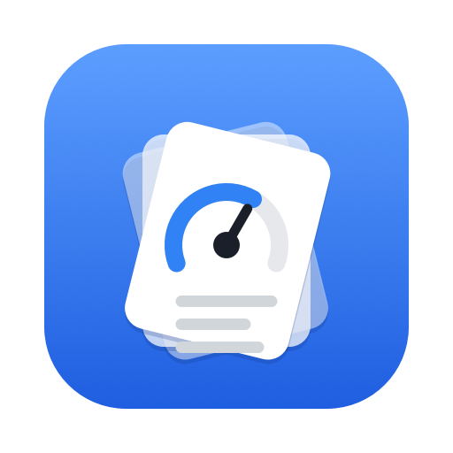
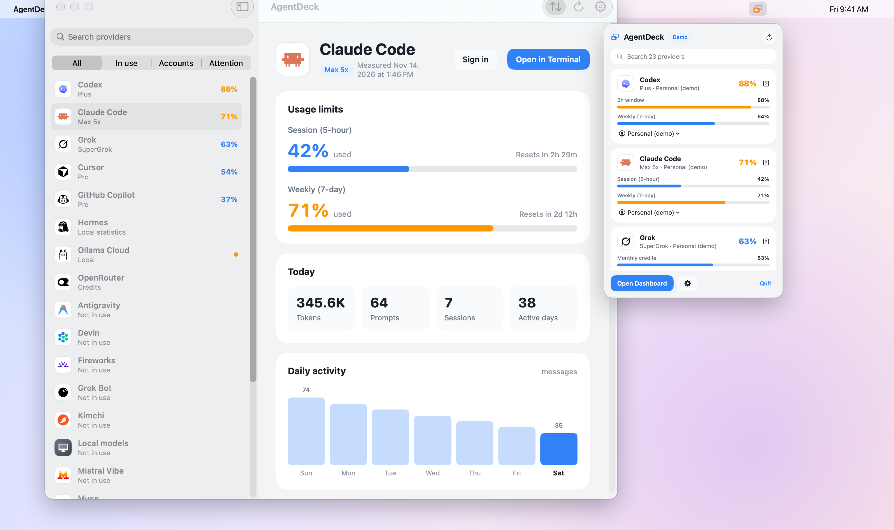
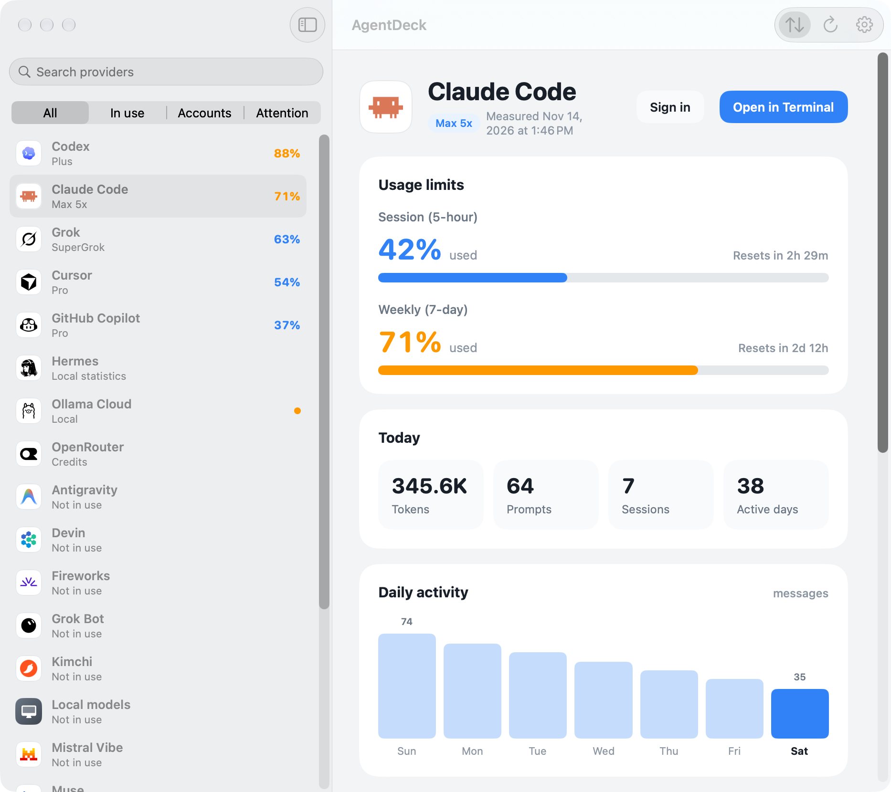
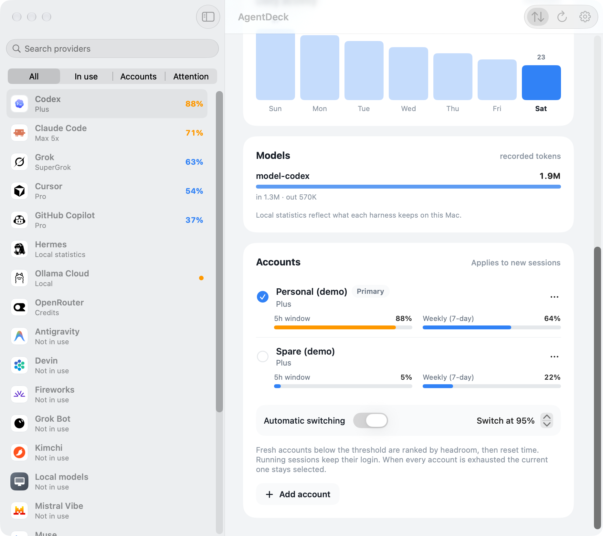
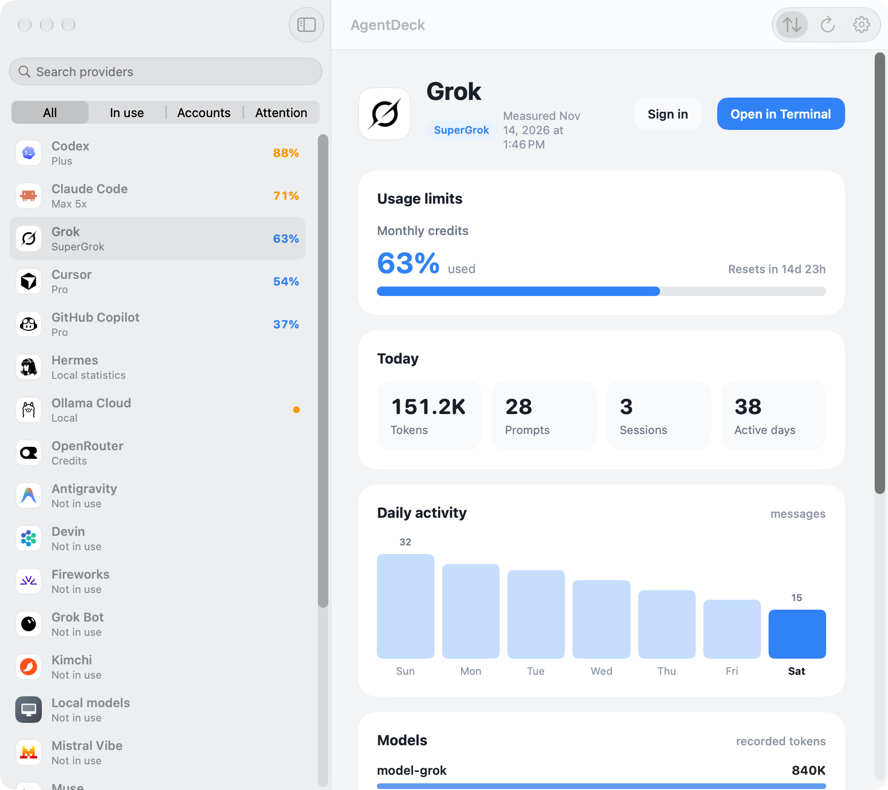
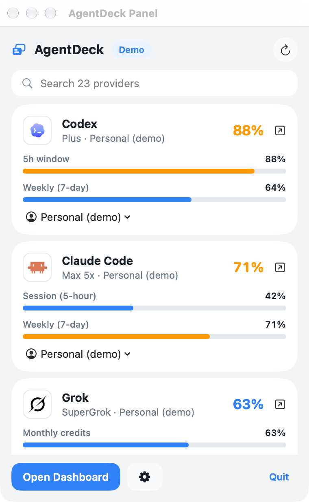
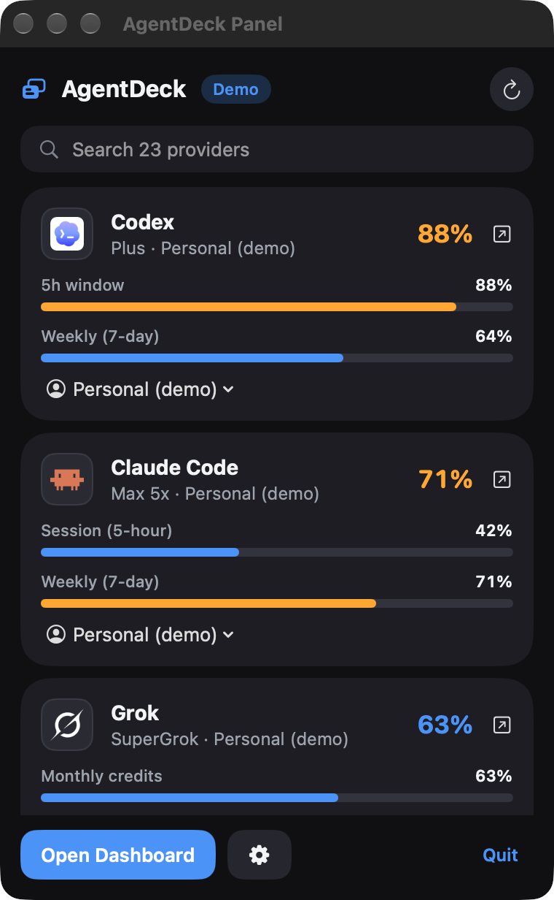
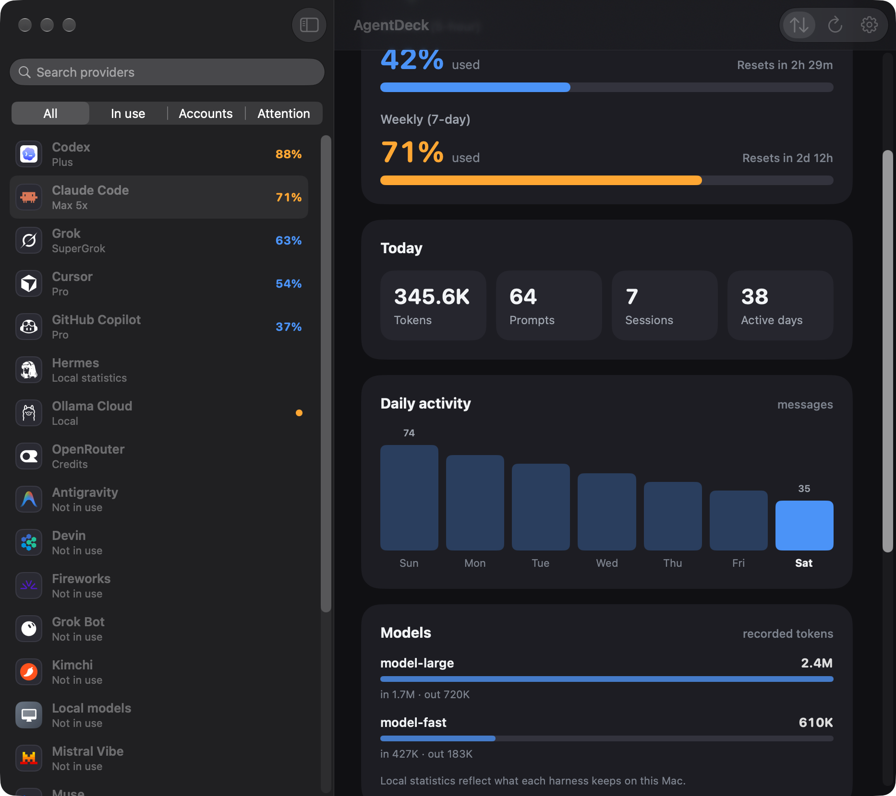
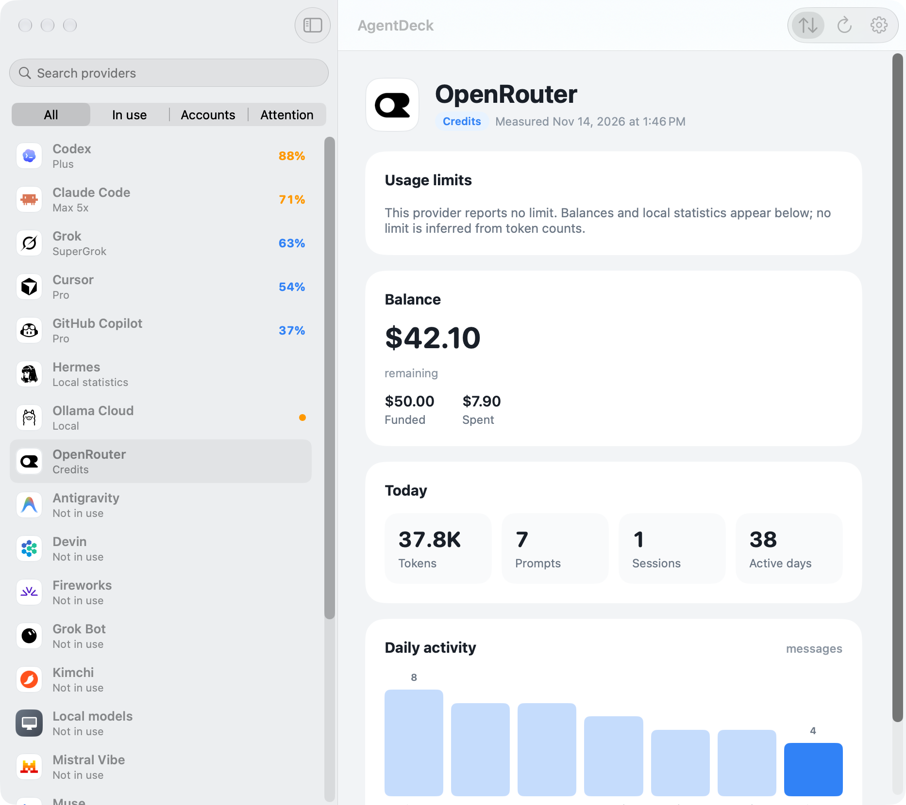
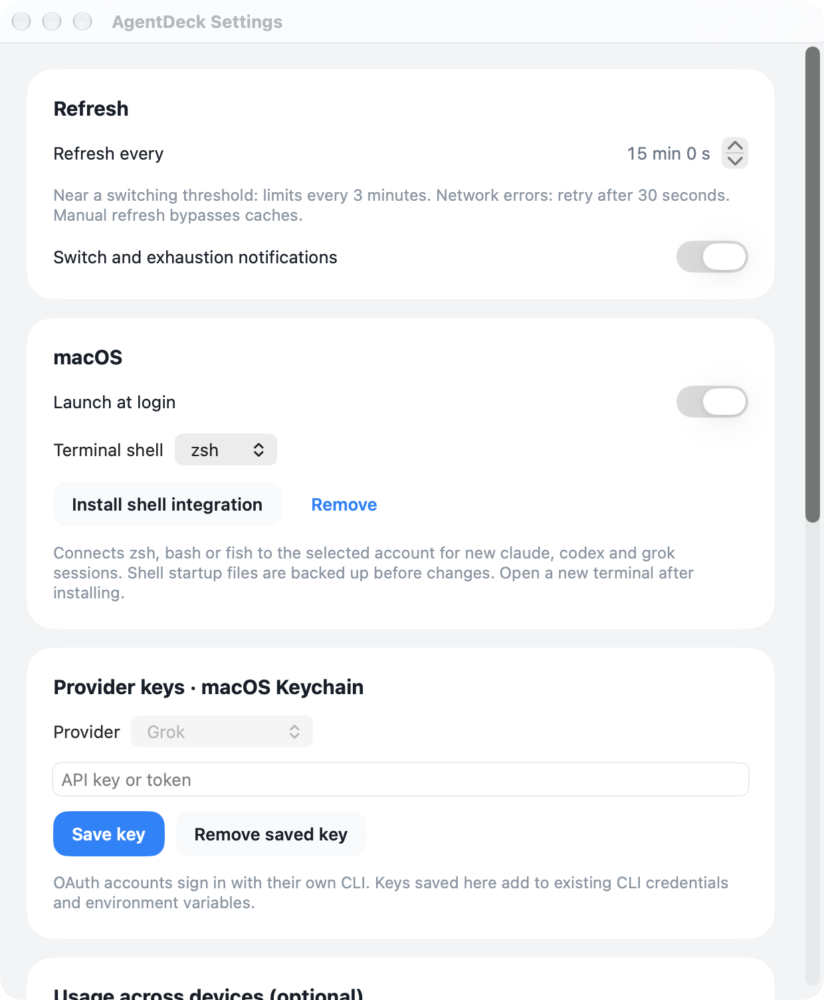

<p align="center"></p>

<h1 align="center">AgentDeck</h1>

<p align="center"><b>Every AI coding agent's limits, balances and accounts — in your Mac's menu bar.</b><br>
<a href="https://jdk1021.github.io/agentdeck/">Website</a> · <a href="README.ko.md">한국어</a></p>

> **Built on the shoulders of [Omarchy](https://github.com/omacom/omarchy).** AgentDeck's 23 usage
> collectors come straight from the agent-usage tooling in Omarchy (MIT, by David Heinemeier Hansson and
> the Omarchy contributors), at tag `v4.5.0`. Their careful work on quota endpoints, billing attribution
> across harnesses, caching and de-duplication is what makes this app accurate. AgentDeck brings that work
> to macOS as a native app. Huge thanks to everyone behind Omarchy.



AgentDeck is a native SwiftUI menu bar app and `agentdeck` CLI for **Apple silicon Macs** on macOS 14+. It shows how much of each
agent's quota you have used, when it resets, what prepaid balances remain, and what you did locally —
and it lets you keep several Claude Code, Codex and Grok sign-ins side by side, switching manually or
automatically before you hit a limit.

## Highlights

- **23 providers, one glance.** Claude Code, Codex, Grok, Cursor, GitHub Copilot, Antigravity,
  OpenRouter, Fireworks and more. Limits, balances and local statistics are kept distinct — a
  limit the provider does not report is never invented.
- **Multiple accounts that don't step on each other.** Each extra Claude Code / Codex / Grok account gets
  its own home and Keychain namespace. MCP servers, hooks, plugins, skills and history are shared with
  your primary setup; credentials never are.
- **Switch before you stall.** Manual switching, or automatic switching at a threshold (default 95%,
  50–100%) ranked by headroom and reset time. Only *new* sessions change account — running ones keep theirs.
- **Your existing tools, untouched.** Uses the CLIs you already installed (mise first). No agent CLI is
  installed or duplicated; existing logins, MCP config, hooks, settings, conversations and databases stay
  where they are.
- **Self-contained.** The `.app` carries its own Python and ripgrep for the collectors — nothing else to
  install.
- **Private by default.** Usage stays on the Mac. Optional cross-device aggregation exports usage numbers
  only — never sign-ins, account details or conversations.

## Screenshots

| Claude Code | Codex accounts | Grok |
|---|---|---|
|  |  |  |

| Menu bar panel | Dark mode |
|---|---|
|  |  |

| Dashboard, dark | OpenRouter balance | Settings |
|---|---|---|
|  |  |  |

All screenshots use the app's built-in synthetic demo mode (`--demo`); no real account data is shown.

## Install

> **Apple silicon only.** AgentDeck requires a Mac with Apple silicon (M1 or later) and macOS 14 or later.
> Intel Macs are not supported.

```sh
brew install --cask jdk1021/tap/agentdeck
```

Or manually:

1. Download `AgentDeck-<version>-macos-arm64.dmg` (or `.zip`) from
   [Releases](../../releases). Check it against the `.sha256` file.
2. Drag **AgentDeck** to Applications.
3. The app is **ad-hoc signed and not notarized** (no Apple Developer ID was available). On first launch
   macOS will refuse to open it: open **System Settings → Privacy & Security** and click **Open Anyway**
   for AgentDeck (or Control-click the app → Open). Do not disable Gatekeeper globally.
4. Optional CLI (Homebrew links it for you): `ln -s /Applications/AgentDeck.app/Contents/MacOS/agentdeck ~/.local/bin/agentdeck`

Build from source: see [docs/installation.md](docs/installation.md). How releases, upstream updates and
dependency updates are automated: [docs/automation.md](docs/automation.md).

## Quick start

```sh
agentdeck refresh              # collect usage for every provider on this Mac
agentdeck status               # one line per provider
agentdeck account add claude Work
agentdeck account login claude <id>      # opens the provider's own sign-in in that account's home
agentdeck account use claude <id|next>   # new sessions use it; running ones are untouched
agentdeck account mode claude auto 95    # automatic switching at 95%
agentdeck run claude -- --continue       # launch with the selected account
agentdeck shell install --shell bash     # optional: claude/codex/grok follow the selection
# --shell zsh (default) and --shell fish are also supported
```

Run `agentdeck help` for every command.

## Providers

| Kind | Providers |
|---|---|
| Limits + multiple accounts | Claude Code, Codex, Grok |
| Limits | Cursor, Grok Bot, GitHub Copilot*, Antigravity, Devin, Mistral Vibe, Ollama Cloud, Synthetic, Kimchi, Muse |
| Balances | OpenRouter, Fireworks*, and balance-based plans of the above |
| Local statistics | Hermes, OpenCode, Local models, and every provider above |
| Additional supported providers | DeepSeek*, Kimi, MiniMax, Qwen Code, Z.ai |

\* can show a locally derived **estimate**, always labelled as such. Full per-provider detail, data
sources and verification status: [docs/support-matrix.md](docs/support-matrix.md).
Provider lists use a consistent display order across the app and CLI. See [display ordering](docs/provider-ordering.md).

## How it works

A Swift core runs the upstream Python collectors (bundled interpreter, bounded concurrency, timeouts,
process-group cleanup), keeps the last good measurement when a refresh fails, and applies the switching
policy. The SwiftUI app and the CLI share that core. Details: [architecture](docs/architecture.md),
[account isolation](docs/account-isolation.md), [upstream analysis](docs/upstream-analysis.md).

## Status

This is the first public release. Read [docs/validation.md](docs/validation.md) for exactly what was
verified on real hardware and accounts and what was not, and [docs/known-limits.md](docs/known-limits.md)
before relying on automatic switching.

## Uninstall

`agentdeck uninstall` removes the zsh block; turn off *Launch at login*, quit, and delete the app. Your
agent logins, settings, histories and AgentDeck's own state are kept — see
[docs/installation.md](docs/installation.md#uninstall) for optional cleanup and restore.

## License

MIT — see [LICENSE](LICENSE). The collectors remain under Omarchy's MIT license and copyright notice;
bundled CPython, ripgrep and provider icons are listed in [THIRD_PARTY_NOTICES.md](THIRD_PARTY_NOTICES.md).
Product names and logos belong to their owners; AgentDeck is not affiliated with any provider.
